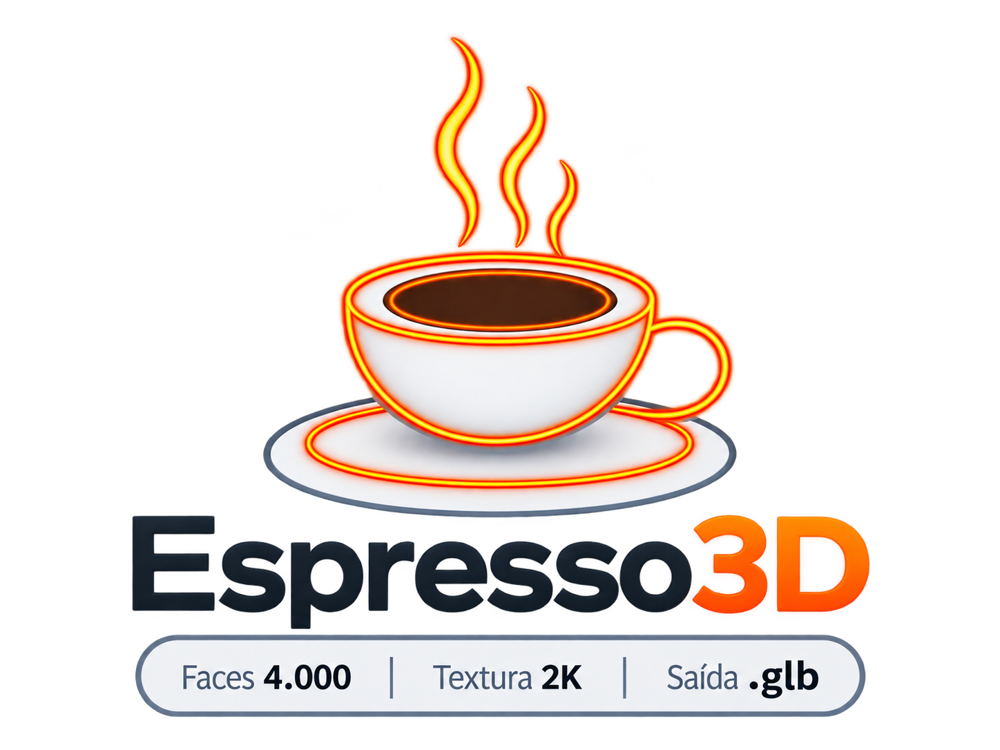

<p align="center">
  <picture>
    <source media="(prefers-color-scheme: dark)" srcset="assets/logo-dark.png">
    <source media="(prefers-color-scheme: light)" srcset="assets/logo-light.png">
    
  </picture>
</p>

# Espresso3D — Research-Oriented Image-to-3D Benchmark Platform

Espresso3D is an open-source platform for **single-image 3D reconstruction experiments** using locally executed AI models.

The project is being reorganized from a general-purpose image-to-3D application into a **reproducible research framework** for evaluating how much geometric and visual information different open-source models can recover from a single image.

The platform combines local 3D generation, standardized experimental execution, quantitative evaluation, hardware profiling, result visualization, and documentation for scientific analysis.

> **Research direction:** *How Much 3D Can One Image Reveal? A Quantitative Benchmark of Open-Source 3D Reconstruction Models*

---

## Research goal

The central objective is to compare open-source single-image 3D reconstruction models under controlled and reproducible conditions.

The study aims to investigate:

- how accurately reconstructed meshes reproduce the geometry of ground-truth objects;
- how well the reconstructed models reproduce the visual appearance of the original object from novel viewpoints;
- how reconstruction quality varies across different object characteristics;
- the computational cost of each reconstruction approach when executed locally;
- where reconstruction errors are spatially concentrated on the generated meshes.

The project therefore treats Espresso3D not only as an application, but also as the **experimental infrastructure used to conduct the research**.

---

## Research questions

The current study is organized around four main research questions:

### RQ1 — Geometric accuracy

How accurately can open-source single-image 3D reconstruction models recover the geometry of real objects?

Candidate metrics include:

- Chamfer Distance;
- Hausdorff Distance;
- MSRE or another surface reconstruction error metric defined in the experimental protocol.

### RQ2 — Visual fidelity

How closely do rendered novel views of reconstructed objects match reference images?

Candidate metrics include:

- LPIPS;
- SSIM;
- PSNR.

### RQ3 — Computational efficiency

What computational resources are required by each reconstruction approach when executed locally?

The benchmark should record, when possible:

- generation time;
- peak GPU memory usage;
- peak system memory usage;
- number of vertices and faces;
- output file size;
- hardware and software environment.

### RQ4 — Failure modes

Which object characteristics and spatial regions are associated with larger reconstruction errors?

This analysis should combine numerical metrics with visualizations such as mesh error heatmaps.

---

## Models under evaluation

The first experimental version focuses on three open-source reconstruction pipelines already integrated with Espresso3D:

| Model | Role in the benchmark |
|---|---|
| **TripoSR** | Single-image 3D reconstruction baseline |
| **Stable Fast 3D** | Single-image reconstruction with material-oriented output |
| **InstantMesh** | Multi-view-assisted reconstruction pipeline initialized from a single image |

Additional models may be incorporated later, provided they can be executed under a documented and comparable protocol.

---

## Experimental protocol

The scientific evaluation should separate the normal application workflow from the benchmark workflow.

A typical experiment should follow this sequence:

```text
Input image
    ↓
3D reconstruction
    ↓
Generated mesh
    ↓
Mesh normalization
    ↓
Alignment with ground truth
    ↓
Surface sampling
    ↓
Geometric metrics
    ↓
Novel-view rendering
    ↓
Image metrics
    ↓
Hardware and execution profiling
    ↓
Results + visualizations
```

To ensure fair comparison, experiments should document and control:

- input image;
- image resolution;
- model version;
- model configuration;
- preprocessing steps;
- reconstruction parameters;
- random seed, when applicable;
- mesh normalization procedure;
- alignment procedure;
- rendering configuration;
- hardware;
- software versions;
- number of repetitions.

Manual mesh corrections should not be performed before quantitative evaluation unless they are explicitly part of a separate experiment.

---

## Dataset strategy

The first version of the benchmark may use a small **pilot dataset** to validate the experimental pipeline.

The initial proposal currently considers five ground-truth objects, with one input image per object.

For the final study, the dataset may be expanded to include a broader range of geometric and visual characteristics, for example:

| Category | Examples | Relevant challenge |
|---|---|---|
| Simple geometry | box, bottle, vase | Global shape recovery |
| Asymmetric objects | mug with handle, shoe | Occlusion and asymmetry |
| Curved surfaces | cup, toy, sculpture | Smooth surface reconstruction |
| Thin structures | chair, handles, open structures | Geometry preservation |
| Reflective or glossy materials | metal, glass, porcelain | Appearance ambiguity |

The final dataset size and categories should be fixed before the main experiment and documented in the article.

---

## Benchmark outputs

Each experimental run should produce enough metadata to be independently inspected and reproduced.

Suggested structure:

```text
research/
├── datasets/
│   ├── ground_truth/
│   └── input_images/
├── experiments/
│   ├── configs/
│   ├── runs/
│   └── results/
├── metrics/
├── scripts/
└── README.md
```

Example run output:

```text
research/experiments/results/benchmark-YYYY-MM-DD/
├── config.json
├── environment.json
├── geometry_metrics.csv
├── image_metrics.csv
├── performance.csv
├── meshes/
├── renders/
└── visualizations/
```

Each generated model should retain metadata such as:

- object identifier;
- reconstruction engine;
- model version;
- seed;
- source image;
- ground-truth reference;
- execution time;
- peak VRAM;
- peak RAM;
- vertex count;
- face count;
- geometric metrics;
- image metrics.

---

## Reproducibility

A key objective of the project is to make the experiments executable without relying on the graphical interface.

The target workflow is a command-line benchmark similar to:

```bash
python research/scripts/run_benchmark.py \
  --dataset espresso3d-benchmark \
  --engines triposr stable-fast-3d instantmesh \
  --runs 3
```

The benchmark runner should:

1. load a fixed experiment configuration;
2. execute each reconstruction engine;
3. save raw outputs;
4. normalize and align generated meshes;
5. compute quantitative metrics;
6. record execution and hardware information;
7. export machine-readable results;
8. generate visualizations for later analysis.

---

## Result visualization

The research version of Espresso3D should provide visual tools that help interpret the numerical results.

Planned visualizations include:

- side-by-side ground-truth and reconstructed meshes;
- per-model metric tables;
- error heatmaps mapped directly onto reconstructed meshes;
- novel-view comparisons;
- execution-time comparisons;
- VRAM and RAM usage comparisons;
- result distributions across object categories.

These visualizations are intended to support both the scientific analysis and the presentation of the work.

---

## Software and research layers

Espresso3D is organized conceptually into two complementary layers:

```text
ESPRESSO3D
│
├── SOFTWARE PLATFORM
│   ├── User interface
│   ├── Reconstruction engines
│   ├── Generation pipeline
│   ├── Export
│   ├── Model library
│   └── Optional agent-based configuration
│
└── RESEARCH FRAMEWORK
    ├── Dataset
    ├── Ground truth
    ├── Experiment runner
    ├── Mesh alignment
    ├── Quantitative metrics
    ├── Hardware profiling
    ├── Statistical analysis
    └── Result visualization
```

The software layer supports interactive use.

The research layer is responsible for controlled, reproducible experimentation.

---

## Current priorities

The current development priority is the scientific evaluation pipeline rather than adding new end-user features.

Planned work:

- [ ] Create the `research/` structure
- [ ] Define the pilot dataset
- [ ] Define the final experimental protocol
- [ ] Implement mesh normalization
- [ ] Implement ground-truth alignment
- [ ] Implement Chamfer Distance
- [ ] Implement Hausdorff Distance
- [ ] Define and implement the third geometric error metric
- [ ] Implement LPIPS
- [ ] Implement SSIM
- [ ] Implement PSNR
- [ ] Record generation time
- [ ] Record peak VRAM usage
- [ ] Record peak RAM usage
- [ ] Export benchmark results to CSV/JSON
- [ ] Generate mesh error heatmaps
- [ ] Create automated experiment reports
- [ ] Run the five-object pilot experiment
- [ ] Review the protocol before expanding the dataset

---

## Existing software

The current Espresso3D application already provides:

- local image-to-3D generation;
- TripoSR, Stable Fast 3D and InstantMesh integration;
- mesh post-processing;
- export to multiple 3D formats;
- batch processing;
- segmentation;
- rigging and pose-related features;
- a generated-model library;
- optional natural-language configuration through local or external LLM backends.

These features remain part of the software, but they are not all considered central contributions of the scientific evaluation.

For installation and software-specific documentation, see:

- [Software documentation](docs/software/)
- [Setup guide](docs/software/SETUP.md)

For the research article and related material, see:

- [Article documentation](docs/article/)
- [Initial research proposal](docs/article/nosso-artigo/01_proposta-inicial_How_Much_3D_Can_One_Image_Reveal.pdf)

---

## Article

The current provisional article title is:

> **How Much 3D Can One Image Reveal? A Quantitative Benchmark of Open-Source 3D Reconstruction Models**

The article is currently in the planning stage.

The repository is intended to keep the implementation, experimental protocol, raw results, derived metrics, visualizations, and article documentation connected to the same reproducible research project.

---

## Development status

This repository is under active development.

The original Espresso3D interface remains available while the research-oriented benchmark infrastructure is being developed.

The current `README.md` describes the application-oriented version of the project.

This file, `README-new.md`, documents the proposed research-oriented direction before replacing the main project README.

---

## License

The Espresso3D source code is released under the [MIT License](LICENSE).

Integrated AI models retain their own licenses and usage conditions. Model versions and licenses used in the experiments should be recorded as part of the scientific protocol.
