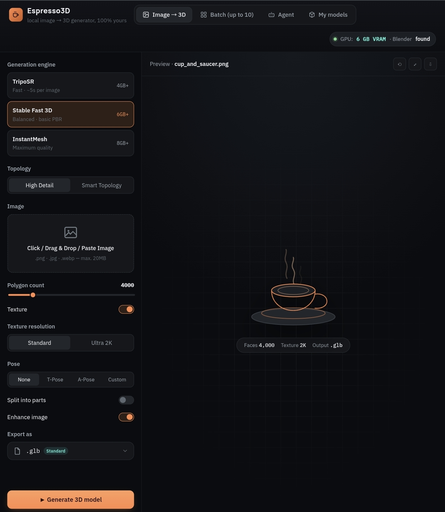

<p align="center">
  <picture>
    <source media="(prefers-color-scheme: dark)" srcset="assets/brand/logo-dark.png">
    <source media="(prefers-color-scheme: light)" srcset="assets/brand/logo-light.png">
    
  </picture>
</p>

<p align="center"><em>Turn an image into a 3D model on your own machine.</em></p>

<p align="center">
  
  
  <a href="LICENSE"></a>
</p>

Espresso3D is a local image-to-3D application with a Gradio interface. The
interface and export tools work without a generation engine; creating models
requires CUDA-enabled PyTorch, an installed engine, and its model weights.

## Preview

<p align="center">
  
</p>

[Open the interactive mockup](https://lianeheidemann.github.io/espresso-3d/) ·
The mockup previews the interface; it does not generate 3D models.

## Features

- Image-to-3D configuration, batch runs, and model library.
- Mesh processing and export to formats including GLB, OBJ, STL, FBX, USDZ,
  and VRM.
- Optional natural-language agent with Ollama or cloud providers.
- Optional image enhancement and object-part segmentation.
- Rigging, pose application, and pose extraction from photos are not yet
  implemented.

## Quick start

Requires Python 3.10 or newer. To open the local interface:

```powershell
git clone https://github.com/lianeheidemann/espresso-3d.git
cd espresso-3d
py -3.11 -m venv .venv
.\.venv\Scripts\Activate.ps1
python -m pip install --upgrade pip
python -m pip install -e ".[dev]"
python -m espresso3d
```

Open `http://localhost:7860`. For a guided Windows and VS Code setup, see
[`docs/step-by-step-vscode.md`](docs/step-by-step-vscode.md). See the
[hardware requirements](docs/requisitos-hardware.md) before selecting a 3D engine.

### 3D generation

Practical generation requires CUDA-enabled PyTorch, an engine, and its weights;
an NVIDIA GPU is recommended. CPU generation may be much slower. Engine adapters
are present, but local image generation has not yet been validated for this
project.

| Engine | Suggested VRAM | Notes |
|---|---:|---|
| TripoSR | 4 GB+ | Fast; no PBR textures |
| Stable Fast 3D | 6 GB+ | PBR textures; check its model license for commercial use |
| InstantMesh | 8 GB+ | Multi-view generation |

Install only the engine you intend to use. Engine packages and model weights
are maintained separately and may have their own requirements and licenses.

### Optional integrations

| Integration | Purpose | Current status |
|---|---|---|
| Blender | Additional export formats, including FBX and USDZ | Required for some formats |
| Segment Anything | Split an image into separate objects | Optional; needs a model checkpoint |
| Real-ESRGAN | Image enhancement | Optional |
| Ollama or cloud provider | Natural-language agent | Optional; keyword mode is available |
| UniRig / MediaPipe | Rigging and pose tools | Not implemented; installing them alone does not enable these features |

## Development

Install the development dependencies with `python -m pip install -e ".[dev]"`.
Run the test suite with:

```powershell
python -m pytest -q
```

As of 2026-11-03, the local setup passed 81 tests on Python 3.11.9 and Gradio
6.31.0. This is an environment snapshot, not a guarantee for every supported
configuration.

### Project layout

```text
espresso-3d/
├── assets/             # project images and visual media
├── docs/               # setup and project documentation
├── mockup/             # static interactive preview published to GitHub Pages
├── src/espresso3d/     # application, engines, pipeline, agent, and library
├── tests/              # automated tests
├── AGENTS.md           # contributor guidance
├── pyproject.toml      # package metadata and dependency ranges
└── requirements.txt    # dependency list and observed versions
```

To add an engine, implement the `Engine` interface under
`src/espresso3d/engines/` and register it in `ENGINES`.

## License

The application source is licensed under [MIT](LICENSE). Integrated models and
optional tools may have separate licenses; review them before commercial use.
