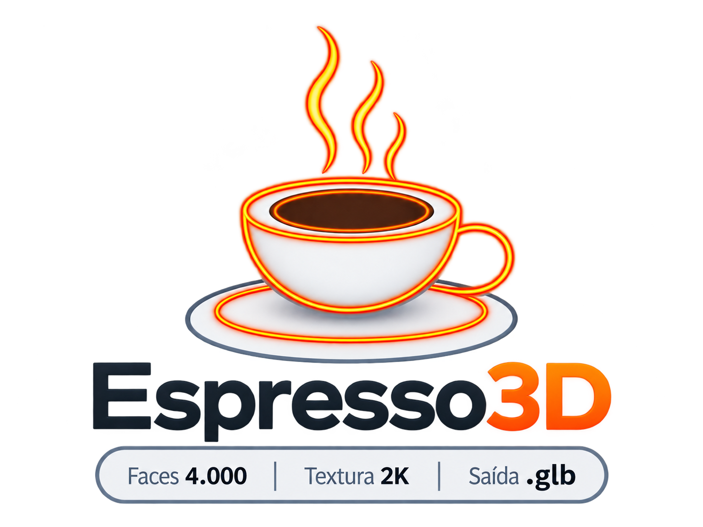
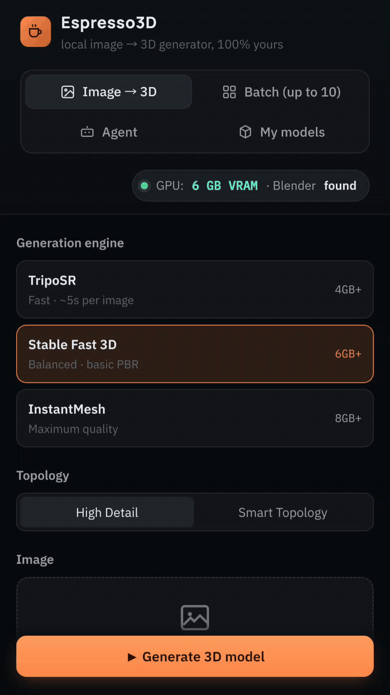

<p align="center">
  <picture>
    <source media="(prefers-color-scheme: dark)" srcset="assets/brand/logo-dark.png">
    <source media="(prefers-color-scheme: light)" srcset="assets/brand/logo-light.png">
    
  </picture>
</p>

---

<p align="center">
   
</p>

<p align="center"><em>Turn a photo into a 3D model — on your own machine, with open-source models.</em></p>

<p align="center">
  
  
  
  
  <a href="LICENSE"></a>
</p>

<p align="center">
  <a href="https://github.com/lianeheidemann/espresso-3d/actions/workflows/pages/pages-build-deployment">
    
  </a>
</p>

Espresso3D is a self-hosted image-to-3D generator. It runs entirely on your
own hardware using open-source models — no subscription, no credit system,
and your images never leave your machine.

## Interface

**Web**

<p align="left">
  
</p>

**Mobile**



**[Live UI preview →](https://lianeheidemann.github.io/espresso-3d/)** *(interactive
mockup of the screens, responsive on mobile; 3D generation itself runs locally)*

---

## Features

| | |
|---|---|
| **Image → 3D** | Choose the engine, target polygon count, texture resolution and PBR output |
| **Batch processing** | Up to 10 images per run, all sharing the same configuration |
| **Part splitting** | A photo of a cup and saucer produces two separate objects instead of one fused mesh |
| **Rigging and posing** | Planned; UniRig rigging and pose application are incomplete |
| **AR/VR export** | `.glb`, `.usdz`, `.fbx`, `.vrm`, `.usdc` and more, grouped by target platform |
| **Natural-language agent** | Describe what you want; review the parsed configuration before it runs |
| **Model library** | Browse, search and delete generated models, with safe deletion to the system trash |

---

## Quick start

**Requirements:** Python 3.10 or newer. An NVIDIA GPU is required for 3D
generation, but not to explore the interface.

```bash
git clone https://github.com/lianeheidemann/espresso-3d.git
cd espresso-3d
python -m venv .venv && source .venv/bin/activate    # Windows: .venv\Scripts\activate
pip install -r requirements.txt
pip install -e .
python -m espresso3d
```

The interface opens at `http://localhost:7860`.

This gives you the full UI, mesh post-processing, export to the lightweight
formats, and the model library. **To actually generate 3D models**, install
PyTorch with CUDA and at least one engine below.

> **Step-by-step guides:** [`docs/software/GUIA-VSCODE-PT-BR.md`](docs/software/GUIA-VSCODE-PT-BR.md) (first run in VS Code, in Portuguese) · [`docs/software/SETUP.md`](docs/software/SETUP.md) (component installation and troubleshooting).

### 3D generation engines

All engines require PyTorch with CUDA. Install whichever fits your GPU:

| Engine | VRAM | Weights license | Commercial use | PBR | Local status | Installation |
|---|---|---|---|---|---|---|
| **TripoSR** | 4 GB+ | MIT | Yes | — | Adapter in source; local generation not verified | `pip install git+https://github.com/VAST-AI-Research/TripoSR.git` |
| **Stable Fast 3D** | 6 GB+ | Stability AI Community | Conditional ¹ | Yes | Adapter in source; local generation not verified | `pip install git+https://github.com/Stability-AI/stable-fast-3d.git` |
| **InstantMesh** | 8 GB+ | Apache 2.0 | Yes | Yes | Adapter in source; local generation not verified | `git clone https://github.com/TencentARC/InstantMesh && pip install -r InstantMesh/requirements.txt` |

¹ The Stability AI Community License is free for personal use and for
organizations under USD 1M in annual revenue. Selecting **License: Commercial**
in the interface hides engines that do not qualify.

Model weights are downloaded from Hugging Face on first use (several GB) and
cached locally. They are excluded from version control.

### Optional components

| Feature | Requirement | Behavior without it |
|---|---|---|
| `.fbx` `.usdz` `.usdc` `.dae` `.blend` export | [Blender](https://www.blender.org/download/) | Only the lightweight formats are offered; the UI explains why |
| `.vrm` avatar export | Blender + VRM add-on | Format unavailable |
| Part splitting | `pip install segment-anything` + `vit_b` checkpoint in `checkpoints/` | Generates the object as a single mesh |
| Image enhancement | `pip install realesrgan basicsr` | Falls back to Lanczos resampling |
| Agent tab | [Ollama](https://ollama.com) + `ollama pull gemma3:4b` | Falls back to keyword parsing |
| Rigging and pose | [UniRig](https://github.com/VAST-AI-Research/UniRig) | Integration is incomplete; installing UniRig does not enable rigging or poses yet |
| Pose from reference photo | `pip install mediapipe` | Not implemented yet; installing MediaPipe does not enable photo-based posing |

If Blender is not on your `PATH`, point to it explicitly:
`export BLENDER_BIN=/path/to/blender`.

### Not implemented yet

- **Rigging and pose application (UniRig):** the application cannot create a
  skeleton or apply T-Pose, A-Pose, or custom poses yet. Installing UniRig
  alone does not enable these features.
- **Pose extraction from a reference photo (MediaPipe):** this is a
  placeholder. Installing MediaPipe alone does not enable photo-based posing.

Text pose descriptions can be converted into candidate bone rotations, but
they cannot be applied until the rigging integration is completed. The SAM,
Real-ESRGAN, and 3D engine adapters have implementation code; they remain
optional integrations and still need their packages, weights, and local
hardware validation.

---

## Export formats

Formats are grouped by where the model is going, not alphabetically:

| Group | Formats | Needs Blender | Carries rig | Carries texture |
|---|---|---|---|---|
| Web and Android AR | `.glb` `.gltf` | No | Yes | Yes |
| iOS / Vision Pro AR | `.usdz` | Yes | Yes | Yes |
| USD / Omniverse pipelines | `.usdc` `.usda` | Yes | Yes | Yes |
| Unity / Unreal / VR | `.fbx` | Yes | Yes | Yes |
| VR avatars | `.vrm` | Yes + add-on | Yes | Yes |
| General editing | `.obj` `.ply` `.dae` `.blend` | Partial | Partial | Partial |
| 3D printing | `.stl` `.3mf` | No | No | `.stl` no |

The interface warns before exporting whenever the selected format discards
texture or skeleton data. `.obj` is delivered zipped alongside its `.mtl` and
texture files.

---

## Output structure

Each generation creates a self-contained folder under `outputs/`:

```
outputs/2026-09-05_143012_cup_and_saucer/
├── cup_and_saucer.glb      # the formats you selected
├── cup_and_saucer.fbx
├── source.png              # the original input image
└── meta.json               # engine, polygon count, pose, license, duration
```

**There is no database.** The library is built by scanning
`outputs/*/meta.json`, which means you can move, copy or back up the folder
freely, and deleting a model is simply removing its directory — no orphaned
files and no index to fall out of sync.

Deleting through the interface sends the folder to the **system trash** by
default; permanent deletion is an explicit opt-in.

---

## Agent

The agent translates a plain-language request into a pipeline configuration.
Pick its backend in the Agent tab — all options are free:

| Backend | Download | Runs on | Vision |
|---|---|---|---|
| Gemma 3 4B | 3.3 GB | Any GPU, or CPU | Yes |
| Qwen 2.5 3B | 2.0 GB | Any GPU, or CPU | No |
| Qwen 2.5 7B | 4.7 GB | 8 GB VRAM, or CPU | No |
| Llama 3.1 8B | 4.9 GB | 8 GB VRAM, or CPU | No |
| Mistral 7B | 4.4 GB | 6 GB VRAM, or CPU | No |
| Moondream 2B | 1.7 GB | Any GPU, or CPU | Yes |
| Groq / OpenRouter | — | Cloud, API key required | No |
| Keyword mode | — | No LLM at all | No |

**Keep "Run on CPU" enabled** if your GPU has 8 GB or less. The agent only has
to produce a small JSON object, so leaving it on the CPU keeps the entire VRAM
budget available for 3D generation.

The agent **never generates anything on its own** — it builds the
configuration, presents it for confirmation, and waits for approval.

---

## Known limitations

These are stated up front rather than discovered later:

- **Automatic rigging is best-effort.** It works well on clearly humanoid
  characters and can fail on stylized shapes. The interface reports the
  failure instead of producing a broken skeleton.
- **PBR support depends on the engine.** TripoSR does not produce
  metalness/roughness maps.
- **Batch runs are sequential.** With 4–8 GB of VRAM, running generations in
  parallel causes both to fail.
- **Output quality does not match commercial services.** Open models come
  close, but not to pipelines trained on proprietary datasets.
- **Text-described poses are approximate.** They capture "seated, arms
  crossed" reliably, not a specific elbow angle. Use a reference photo when
  precision matters.

---

## Development

```bash
python -m pytest -q
```

The test suite covers the logic that does not require a GPU: configuration
validation, mesh decimation, export routing, agent request parsing, pose
rotation validation, and the model library.

### Verified local environment

Snapshot from a Windows PowerShell setup on **2026-11-03**. These are the
versions used for the first local run; they are a record of one working
development environment, not pinned requirements for every installation.

| Component | Version or status |
|---|---|
| Git for Windows | 2.54.0.windows.1 |
| Python | 3.11.9 in `.venv` |
| pip | 26.3 |
| Espresso3D | 0.1.0, editable install |
| Gradio | 6.31.0 |
| NumPy | 2.4.6 |
| SciPy | 1.17.1 |
| Pillow | 12.3.0 |
| trimesh | 5.2.0 |
| fast-simplification | 0.2.0 |
| Send2Trash | 2.1.0 |
| pytest | 9.2.0; all 81 tests passed |
| GPU | NVIDIA GeForce RTX 3060, 6 GB |
| NVIDIA driver | 610.62 |
| CUDA reported by `nvidia-smi` | UMD 13.3; this is the driver report, not a PyTorch check |
| PyTorch with CUDA | Not installed or verified yet |
| 3D engine packages and weights | Not installed or validated yet |

The local application uses Python with Gradio for the interface and NumPy,
SciPy, Pillow, trimesh, and fast-simplification for image and mesh processing.
The code includes adapters for TripoSR, Stable Fast 3D, and InstantMesh.
Actual GPU generation still requires installing a CUDA-enabled PyTorch build
and at least one engine with its model weights; this setup has only confirmed
that Windows detects the NVIDIA GPU and that the interface and CPU-independent
tests run.

### Repository layout

```
espresso-3d/
├── .github/
│   └── workflows/
│       └── pages.yml                 # publishes mockup/ to GitHub Pages
├── assets/                           # project images and visual media
├── docs/
│   └── step-by-step-vscode.md        # first run in Windows and VS Code
├── mockup/
│   ├── .nojekyll
│   └── index.html                    # interactive visual mockup; no 3D generation
├── src/
│   └── espresso3d/
│       ├── ui/                       # functional Gradio interface and theme
│       ├── engines/                  # TripoSR, Stable Fast 3D, InstantMesh adapters
│       ├── pipeline/                 # image prep, segmentation, mesh processing, export
│       ├── agent/                    # request parsing and model backends
│       ├── library/                  # generated model catalog and deletion
│       ├── research/                 # research scaffolding and experiment tools
│       │   ├── dataset/
│       │   ├── ground_truth/
│       │   ├── metrics/
│       │   ├── experiment_runner/
│       │   ├── hardware_profiling/
│       │   ├── statistical_analysis/
│       │   └── result_visualization/
│       ├── software/                 # compatibility entry points during restructuring
│       │   ├── agent/
│       │   ├── export/
│       │   ├── generation/
│       │   ├── interface/
│       │   ├── library/
│       │   ├── pipeline/
│       │   └── README.md
│       ├── config.py                 # pipeline options and validation
│       ├── hardware.py               # GPU, Blender and Ollama detection
│       └── __main__.py               # entry point: python -m espresso3d
├── tests/                            # automated unit tests
├── .gitignore                        # generated files, model weights and local secrets
├── AGENTS.md                         # contributor instructions
├── LICENSE
├── pyproject.toml                    # package metadata and dependency ranges
├── requirements.txt                  # dependencies and verified local versions
└── README.md
```

The `src/` layout is the standard Python convention for separating package
code from repository metadata. `pytest` runs from the repository root
(`pyproject.toml` handles the path); `pip install -e .` makes
`python -m espresso3d` work from any directory.

**Adding an engine:** create a module under `src/espresso3d/engines/`, subclass
`Motor`, and register it in `MOTORES`. The interface picks it up automatically.

---

## License

The Espresso3D source code is released under the [MIT License](LICENSE).

The AI models it integrates carry their own licenses — review the engine table
above before using generated assets commercially.
