# Notas do benchmark

Explicações ilustradas de apoio ao benchmark do Espresso3D:

- [Métricas de comparação de imagens: LPIPS, SSIM e PSNR](#métricas-de-comparação-de-imagens-lpips-ssim-e-psnr)
- [Como ler um boxplot](#como-ler-um-boxplot)
- [Mapas de distância entre malhas](#mapas-de-distância-entre-malhas)

---

## Métricas de comparação de imagens: LPIPS, SSIM e PSNR

Estas três métricas comparam duas imagens: a imagem de referência (*ground truth*) e uma renderização do modelo 3D reconstruído, vista do mesmo ângulo. No benchmark do Espresso3D, elas avaliam o quanto cada modelo (TripoSR, Stable Fast 3D e InstantMesh) se aproxima do objeto real quando visto de novas perspectivas (*novel views*).

| Métrica | O que mede | Faixa de valores | Melhor quando |
|---|---|---|---|
| **LPIPS** | Diferença perceptual, medida por uma rede neural | 0 em diante | Menor ↓ |
| **SSIM** | Semelhança de estrutura, luminância e contraste | até 1 | Mais próximo de 1 ↑ |
| **PSNR** | Relação entre sinal e ruído, em decibéis (dB) | 0 a infinito | Maior ↑ |

---

### LPIPS (*Learned Perceptual Image Patch Similarity*)

O LPIPS mede a diferença entre duas imagens como uma pessoa a perceberia. Em vez de comparar pixel a pixel, ele passa as duas imagens por uma rede neural pré-treinada (como a AlexNet), que extrai características visuais de cada uma. Essas características são comparadas pela norma L2, e o resultado é a média espacial dessas diferenças.

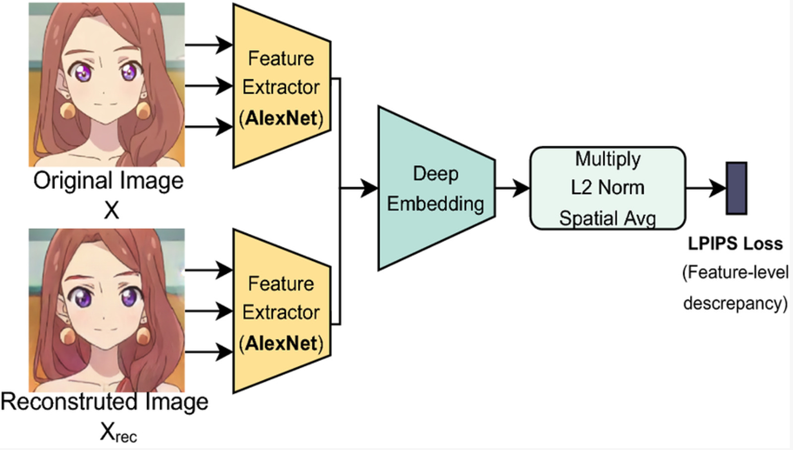

*Figura 1: cálculo do LPIPS. As duas imagens passam por extratores de características (AlexNet), e a diferença entre elas define o valor da métrica.*

**Interpretação:** quanto **menor** o LPIPS, mais semelhantes as imagens são perceptualmente.

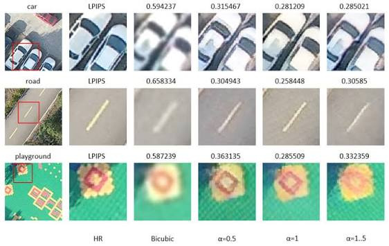

*Figura 2: variação do LPIPS conforme o método de reconstrução aplicado a uma imagem de alta resolução (HR). A interpolação bicúbica tem os valores mais altos, ou seja, é a menos fiel perceptualmente.*

---

### SSIM (*Structural Similarity Index Measure*)

O SSIM também mede a percepção de semelhança entre duas imagens, mas com base em três componentes: luminância, contraste e estrutura.

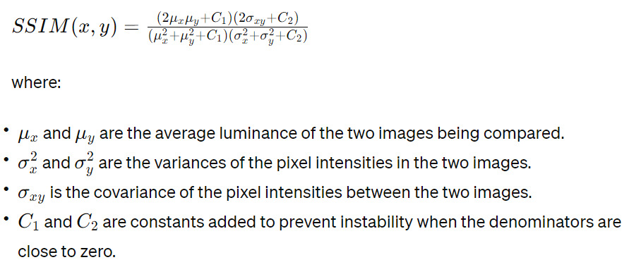

*Figura 3: fórmula do SSIM. μx e μy são as luminâncias médias das duas imagens; σx² e σy² são as variâncias das intensidades dos pixels; σxy é a covariância entre as duas imagens; C1 e C2 são constantes que evitam instabilidade quando os denominadores se aproximam de zero.*

**Interpretação:** quanto **mais próximo de 1**, mais parecida a reconstrução é com a imagem de referência. O valor 1 indica imagens idênticas.

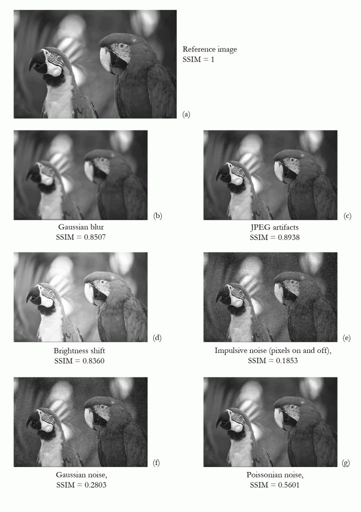

*Figura 4: SSIM da mesma imagem após diferentes distorções: desfoque gaussiano (0,8507), artefatos de JPEG (0,8938), mudança de brilho (0,8360), ruído impulsivo (0,1853), ruído gaussiano (0,2803) e ruído de Poisson (0,5601). Os ruídos derrubam o SSIM muito mais do que o desfoque ou a mudança de brilho.*

---

### PSNR (*Peak Signal-to-Noise Ratio*)

O PSNR mede, em decibéis, a relação entre o valor máximo possível de um pixel (MAX_I) e o erro quadrático médio (MSE) entre as duas imagens. É uma métrica pixel a pixel, sem modelar a percepção humana.

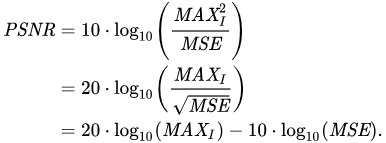

*Figura 5: fórmula do PSNR, em três formas equivalentes.*

**Interpretação:** o PSNR varia de 0 a infinito. Quanto **maior**, mais próxima a reconstrução está da *ground truth*. Imagens idênticas (MSE = 0) têm PSNR infinito.

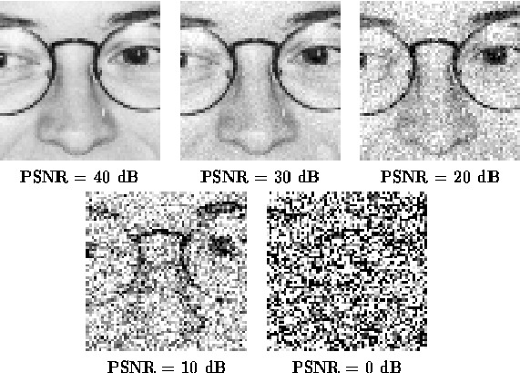

*Figura 6: a mesma imagem com PSNR decrescente. Com 40 dB, a diferença é imperceptível; com 0 dB, a imagem vira ruído.*

---

## Como ler um boxplot

No benchmark, cada modelo gera uma medição por objeto. O boxplot (diagrama de caixa) resume a distribuição dessas medições em uma única figura, o que facilita comparar os modelos lado a lado.

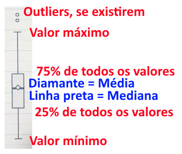

*Figura 7: partes de um boxplot.*

| Elemento | O que indica |
|---|---|
| **Linha dentro da caixa** | Mediana: metade dos valores fica abaixo dela e metade acima. |
| **Diamante (◇)** | Média dos valores. |
| **Base da caixa** | 1º quartil (Q1): 25% dos valores ficam abaixo dele. |
| **Topo da caixa** | 3º quartil (Q3): 75% dos valores ficam abaixo dele. |
| **Altura da caixa** | Faixa dos 50% centrais dos valores (Q3 − Q1). Quanto mais alta a caixa, mais os resultados variam. |
| **Hastes (*whiskers*)** | Vão do menor ao maior valor, sem contar os outliers. |
| **Círculos (○)** | Outliers: valores muito distantes dos demais, quando existem. Na convenção mais comum, são os que ficam a mais de 1,5 × (Q3 − Q1) abaixo de Q1 ou acima de Q3. |

Quando a média fica longe da mediana, a distribuição é assimétrica: alguns valores muito altos ou muito baixos puxam a média para o seu lado.

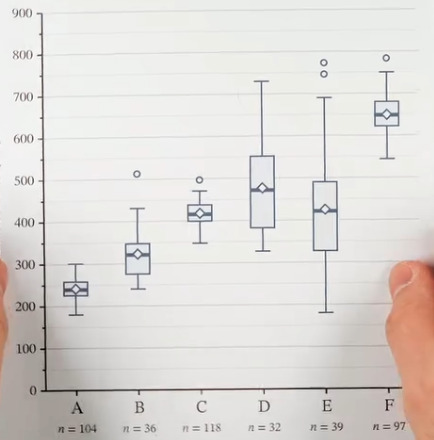

*Figura 8: seis grupos (A a F), com o número de amostras (n) de cada um indicado abaixo. A e C têm caixas baixas, ou seja, valores concentrados; D e E têm caixas e hastes longas, ou seja, valores muito dispersos. B, C, E e F têm outliers. As caixas de A e F estão bem separadas, então esses grupos diferem claramente; as de D e E se sobrepõem bastante, então a diferença entre eles é menos clara.*

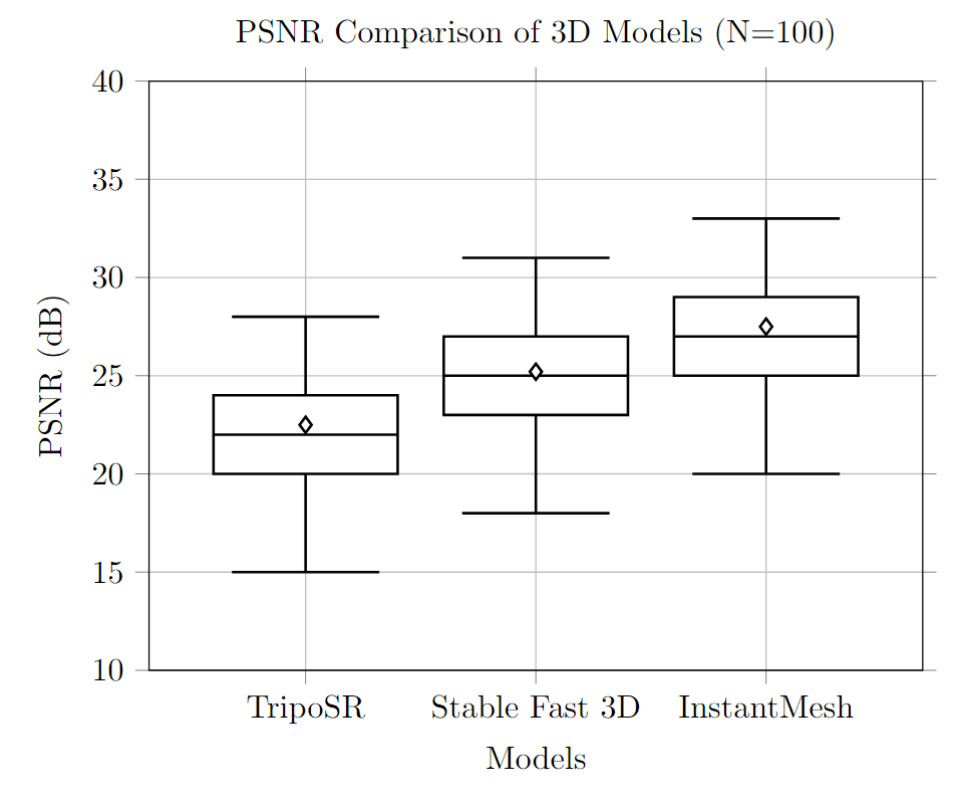

*Figura 9: exemplo de como os resultados de PSNR dos três modelos podem ser apresentados (N = 100). Os valores são ilustrativos; não representam medições realizadas pelo Espresso3D.*

**Interpretação:** como no PSNR maior é melhor, o InstantMesh teria o melhor desempenho neste exemplo (mediana de 27 dB), seguido do Stable Fast 3D (25 dB) e do TripoSR (22 dB). A caixa do Stable Fast 3D se sobrepõe às dos outros dois, e as hastes dos três modelos também se sobrepõem, então essa ordem não vale para todos os objetos: o melhor resultado do TripoSR (28 dB) fica acima da mediana do InstantMesh. Nos três modelos, a média fica um pouco acima da mediana.

---

## Mapas de distância entre malhas

Na comparação geométrica, a malha de referência (GT) é colorida conforme a distância de cada vértice até a malha RM alinhada, como indica a legenda da barra de cores (*GT vertex distance to aligned RM*). As cores da base da barra (perto de 0) marcam as regiões próximas; as do topo, as regiões mais distantes. Ao lado de cada mapa estão os dois renders das malhas comparadas.

Cada mapa tem a sua própria escala, então a mesma cor não indica a mesma distância em objetos diferentes: confira sempre os valores da barra.

### Suzanne

| Mapa de distância | Render 1 | Render 2 |
|---|---|---|
| <a href="10_suzanne-mapa-distancia.jpg">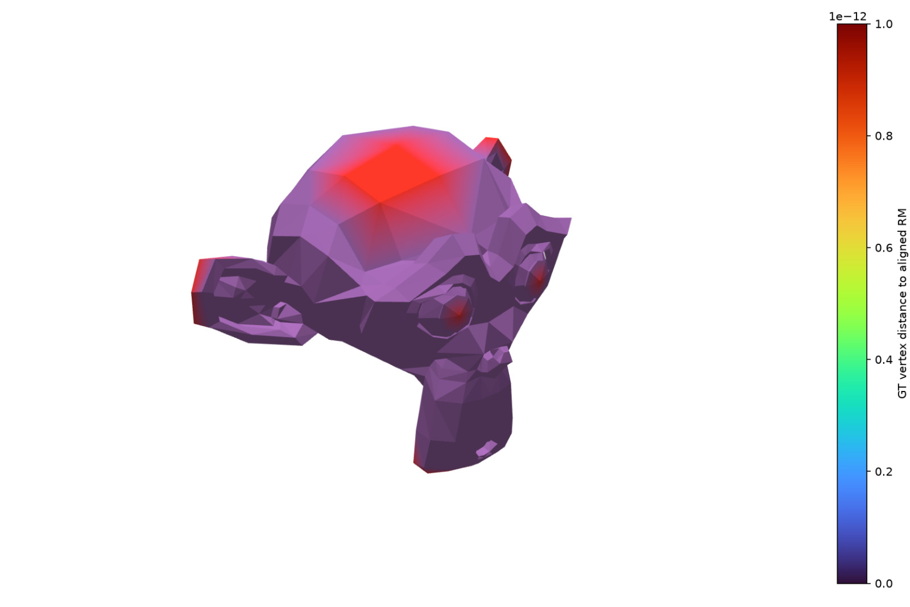</a> | <a href="11_suzanne-render-1.jpg">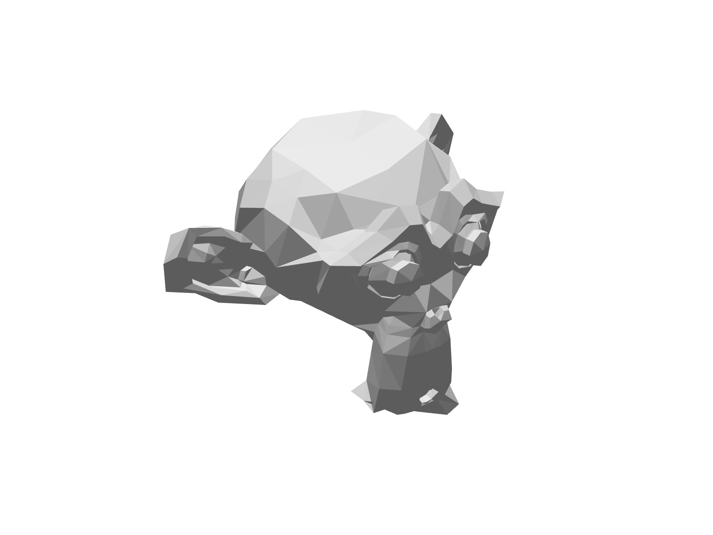</a> | <a href="12_suzanne-render-2.jpg">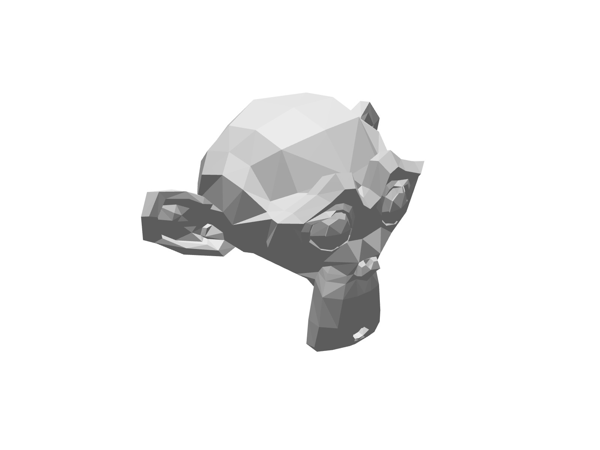</a> |

*Figura 10: Suzanne. A escala vai de 0 a 1 × 10⁻¹², ou seja, as distâncias são praticamente nulas; as regiões vermelhas marcam apenas diferenças da ordem do erro numérico.*

### Gato-aranha

| Mapa de distância | Render 1 | Render 2 |
|---|---|---|
| <a href="13_gato-aranha-mapa-distancia.jpg">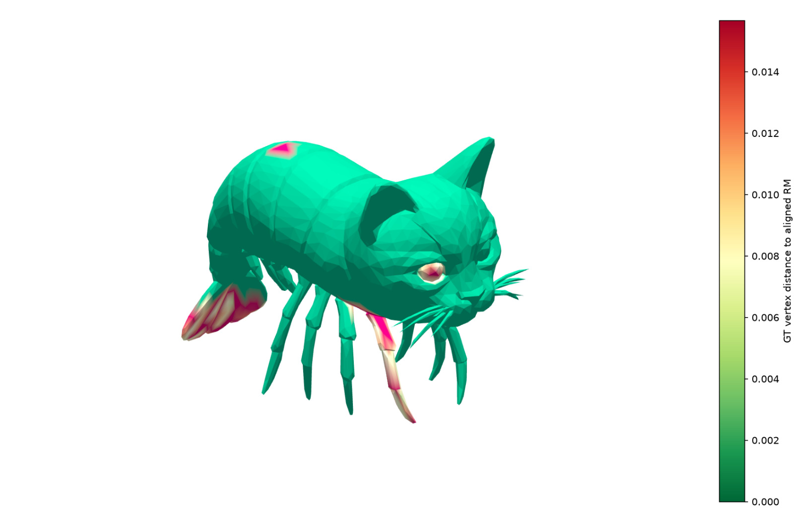</a> | <a href="14_gato-aranha-render-1.jpg">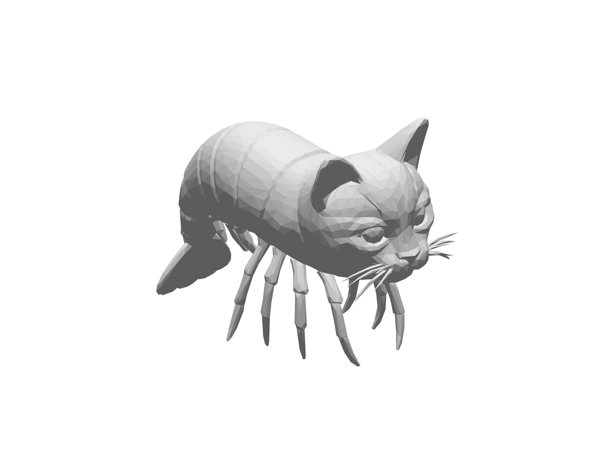</a> | <a href="15_gato-aranha-render-2.jpg">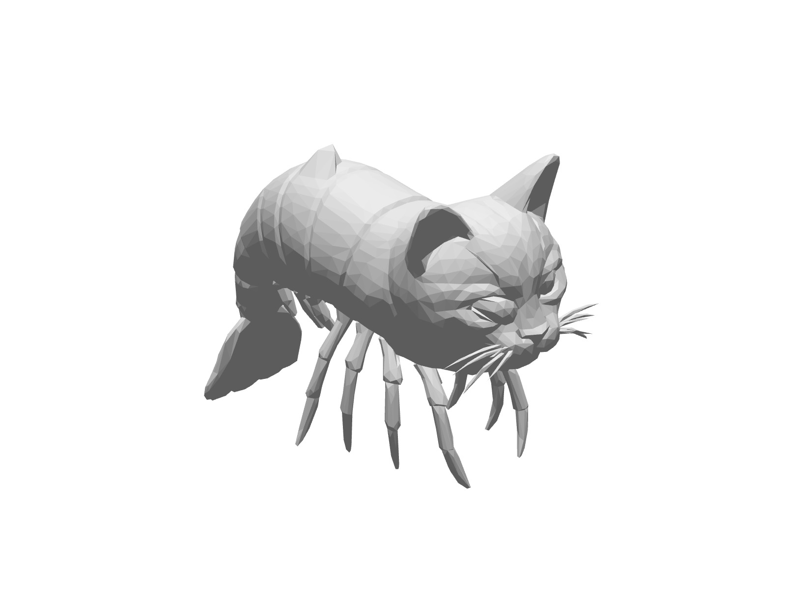</a> |

*Figura 11: gato-aranha. A escala vai de 0 a cerca de 0,015. A maior parte da malha fica em verde (distância próxima de zero); as maiores distâncias aparecem na cauda, em um ponto das costas, no olho e em uma das patas.*
