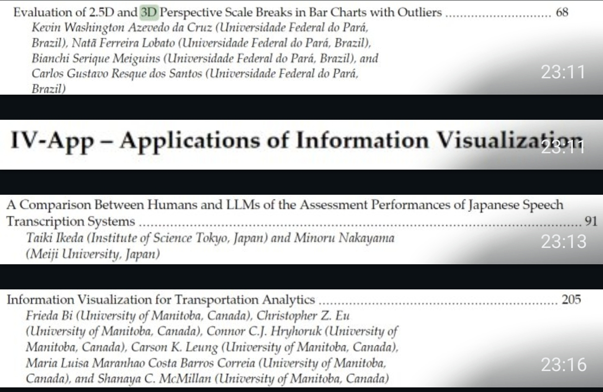

# Notas do artigo

Imagens (prints e figuras) usadas como apoio na escrita do artigo. Os arquivos seguem o padrão de nomes descrito em [`docs/article/README.md`](../README.md#como-nomear-os-arquivos).

## 01 — Trecho do sumário dos anais da IV 2025

Mostra um trabalho de 3D aceito na IV 2025 (*Evaluation of 2.5D and 3D Perspective Scale Breaks in Bar Charts with Outliers*, da Universidade Federal do Pará) e o início da trilha **IV-App — Applications of Information Visualization**, a trilha provável para o nosso artigo. Complementa a referência 01 (sumário completo dos anais, em [`references/`](../references/)).
