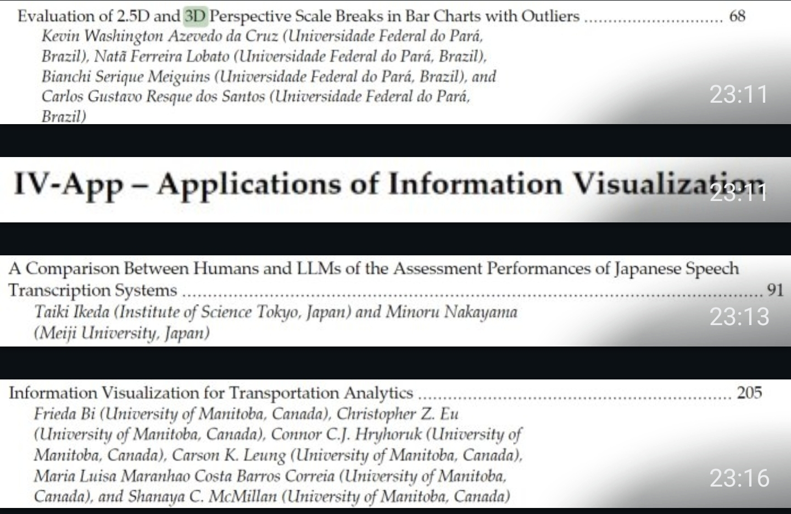

# Artigo científico — organização da escrita

Espaço da equipe para organizar a parte escrita do artigo que está sendo
construído a partir do Espresso3D.

| | |
|---|---|
| **Título provisório** | *How Much 3D Can One Image Reveal? A Quantitative Benchmark of Open-Source 3D Reconstruction Models* |
| **Autores** | Liane Heidemann, Thiago Figueiró Ribeiro |
| **Conferência alvo** | IV 2027 — International Conference Information Visualisation |
| **Status** | Em planejamento |

---

## Documentos de trabalho (Google Docs)

A escrita acontece nestes documentos. O repositório guarda só a organização
e as referências.

- [Modelos de IA para Geração - Outros Registros](https://docs.google.com/document/d/1poDc_deXliMhNq3C-wGayzVEpKDgyadrlTICl-ehsXA/edit?usp=drivesdk)
- [Modelos de IA para Geração 3D - Documentação](https://docs.google.com/document/d/18NzJn0rGdpOQDcMBZqf0_p-OWwCp9N7cLGt8CAy3VPs/edit?usp=drivesdk)

---

## Conferência alvo: IV 2027

- Site: <https://iv.csites.fct.unl.pt/uk/>
- Trilha provável: **IV-App — Applications of Information Visualization**
  (ver o print em [Materiais](#materiais)).

Preencher assim que o call for papers de 2027 sair:

| Item | Valor |
|---|---|
| Prazo de submissão | _a definir_ |
| Notificação de aceite | _a definir_ |
| Camera-ready | _a definir_ |
| Template / formato | _a definir_ |
| Limite de páginas | _a definir_ |

---

## Referências

| Referência | Onde | Nota |
|---|---|---|
| *How Much 3D Can One Image Reveal?* (proposta) | [`references/How_Much_3D_Can_One_Image_Reveal.docx`](references/How_Much_3D_Can_One_Image_Reveal.docx) | Metodologia: 5 objetos ground truth, uma foto de cada, reconstrução com TripoSR, Stable Fast 3D e InstantMesh. Comparação das meshes por Hausdorff (HD), Chamfer (CD) e MSRE; novel views por LPIPS, PSNR e SSIM. |
| Artigo IV 2025 (IEEE CSDL) | <https://www.computer.org/csdl/proceedings-article/iv/2025/774100z006/2bggGgAVhbq> | Referência dos proceedings da IV 2025. |

**Como adicionar uma referência:** coloque o arquivo em `references/` (nome
sem espaços, ex.: `Autor_Ano_Titulo.pdf`) e adicione uma linha nesta tabela.
Referências só com link entram direto na tabela.

---

## Materiais

Print do sumário dos proceedings da IV (trabalho de 3D e a trilha IV-App),
usado como referência do tipo de artigo aceito:

[`screenshots/iv-proceedings-toc.jpg`](screenshots/iv-proceedings-toc.jpg)

---

## Divisão das seções

| Seção | Responsável | Status |
|---|---|---|
| Resumo (Abstract) | | Não iniciado |
| Introdução | | Não iniciado |
| Trabalhos relacionados | | Não iniciado |
| Metodologia | | Rascunho (na proposta) |
| Experimentos | | Não iniciado |
| Resultados | | Não iniciado |
| Discussão | | Não iniciado |
| Conclusão | | Não iniciado |

## Próximos passos

- [ ] Escolher os 5 objetos ground truth
- [ ] Adaptar o Espresso3D para rodar o benchmark (TripoSR, Stable Fast 3D, InstantMesh)
- [ ] Implementar as métricas (HD, CD, MSRE; LPIPS, PSNR, SSIM)
- [ ] Levantar trabalhos relacionados nos proceedings da IV
- [ ] Conferir prazos e template da IV 2027
