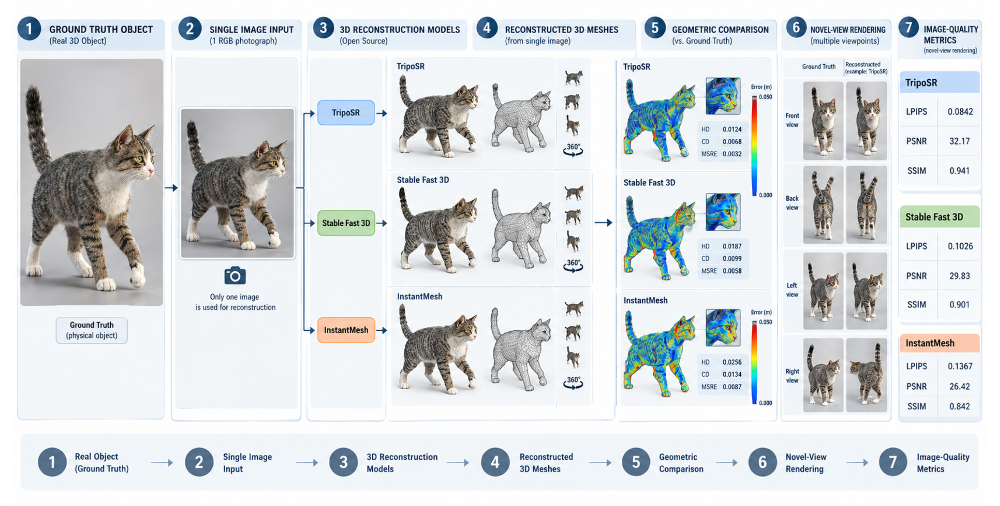
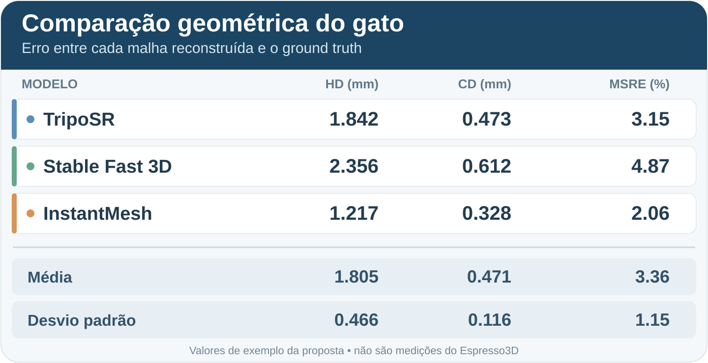
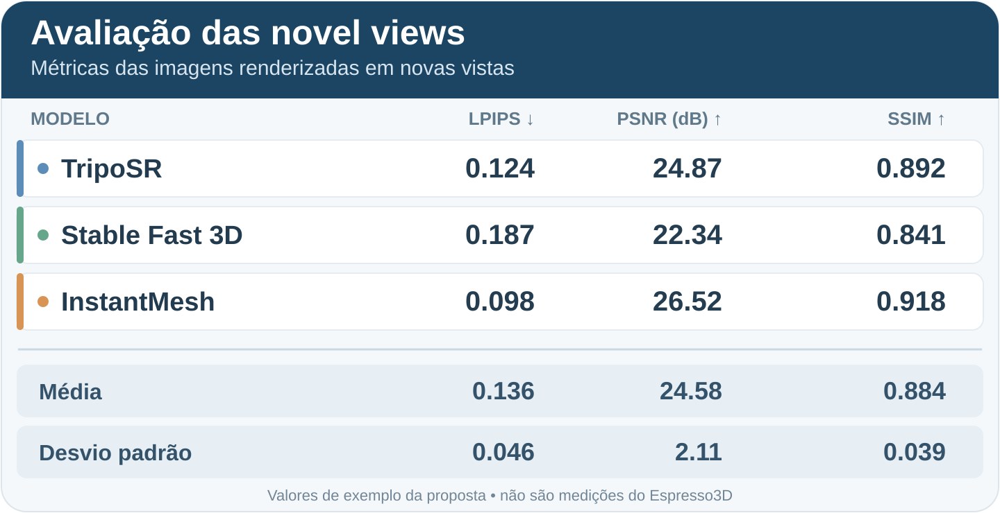

# Documentação do software — Espresso3D

Esta pasta reúne a documentação técnica do **Espresso3D como software**. O objetivo é centralizar as informações necessárias para instalar, configurar, executar, testar e evoluir a aplicação, mantendo-as separadas dos materiais de escrita do artigo científico.

## Documentos

| Documento | Finalidade |
|---|---|
| [SETUP.md](SETUP.md) | Instalação e configuração do ambiente para executar o Espresso3D e gerar modelos 3D localmente. |

## Levantamento técnico

Esta seção descreve as principais tecnologias do projeto e sua relevância para o Espresso3D.

### Tecnologias principais

| Tecnologia | O que é | Relevância para o Espresso3D |
|---|---|---|
| **PyTorch** | Biblioteca de código aberto para aprendizado de máquina em Python. Oferece tensores com aceleração por GPU e diferenciação automática. | É usado pelos motores de geração 3D (`engines/tripo_sr.py`, `engines/stable_fast_3d.py`), pela segmentação com SAM (`pipeline/segment.py`) e pelo aprimoramento de imagem com ESRGAN (`pipeline/enhance.py`). Também é utilizado em `hardware.py` para detectar a GPU e a VRAM disponíveis. |
| **CUDA** | Plataforma de computação paralela da NVIDIA, usada para executar cálculos na GPU. | Permite que o PyTorch execute os modelos na placa de vídeo. Sem CUDA, a inferência é feita na CPU e pode ser muito mais lenta. Consulte [SETUP.md](SETUP.md#2-pytorch-with-cuda--the-step-most-likely-to-go-wrong) para instalar a versão adequada do PyTorch. O aplicativo verifica `torch.cuda.is_available()` para selecionar GPU ou CPU e exibe a VRAM detectada na barra de status. |

### Modelos de geração 3D

Os modelos abaixo transformam imagens em malhas 3D e serão comparados no benchmark do artigo. Os pesos são baixados do Hugging Face no primeiro uso.

| Modelo | Pesos no Hugging Face | VRAM indicada | Licença dos pesos | Perfil no Espresso3D |
|---|---|---:|---|---|
| **TripoSR** | `stabilityai/TripoSR` | 4 GB ou mais | MIT | Geração rápida (`engines/tripo_sr.py`). |
| **Stable Fast 3D** | `stabilityai/stable-fast-3d` | 6 GB ou mais | Stability AI Community | Perfil equilibrado, com textura PBR (`engines/stable_fast_3d.py`). |
| **InstantMesh** | `TencentARC/InstantMesh` | 8 GB ou mais | Apache 2.0 | Perfil voltado à qualidade, com textura PBR (`engines/instant_mesh.py`). |

### Agente — implementação opcional

A aba **Agente** recebe um pedido em linguagem natural, como “gerar um modelo detalhado em GLB para AR”, e o converte em uma configuração de geração (`agent/parser.py`). A configuração interpretada é exibida para a pessoa revisar antes da execução.

O agente pode usar diferentes backends:

| Opção | Onde roda | Observações |
|---|---|---|
| **Gemma 3 4B** (`gemma3:4b`) | Local, via [Ollama](https://ollama.com) | Opção padrão proposta. Tem aproximadamente 3,3 GB e aceita imagens. |
| Qwen 2.5 3B / 7B, Llama 3.1 8B, Mistral 7B e Moondream 2B | Local, via Ollama | Alternativas locais. A proposta é executá-las na CPU para deixar a VRAM disponível para a geração 3D. |
| Groq (`llama-3.1-8b-instant`) e OpenRouter (`llama-3.1-8b-instruct:free`) | Nuvem | Requerem chave de API e conexão com a internet. |
| Modo básico por palavras-chave | Local | Não usa LLM; pode ser utilizado quando nenhum modelo estiver disponível. |

## Benchmark de reconstrução 3D

### Objetivo

Avaliar como modelos de reconstrução 3D de código aberto geram malhas a partir de imagens e comparar os resultados com modelos de referência (*ground truth*).

### Procedimento proposto

1. Selecionar cinco objetos 3D, por exemplo, animais ou brinquedos.
2. Obter ou preparar uma malha de referência (*ground truth*) para cada objeto.
3. Fotografar cada objeto. A quantidade de ângulos usados como entrada ainda precisa ser definida.
4. Gerar uma reconstrução para cada imagem com:
   - TripoSR;
   - Stable Fast 3D;
   - InstantMesh.
5. Comparar as malhas reconstruídas com as respectivas malhas de referência.
6. Organizar os resultados em tabelas e visualizações e concluir qual modelo teve melhor desempenho, considerando as métricas adotadas.

### Métricas propostas

Para a comparação geométrica das malhas:

- **Distância de Hausdorff (HD)**;
- **Distância de Chamfer (CD)**;
- **Mean Square Relative Error (MSRE)**.

Como extensão, comparar *novel views* — imagens renderizadas dos modelos em novas perspectivas — usando:

- **LPIPS**;
- **PSNR**;
- **SSIM**.

Em geral, valores menores são melhores para HD, CD, MSRE e LPIPS; valores maiores são melhores para PSNR e SSIM.

### Exemplo visual dos resultados

A figura e as tabelas abaixo são reproduções em alta resolução do exemplo incluído na proposta original. Os modelos reconstruídos e os valores das tabelas são ilustrativos; não representam medições realizadas pelo Espresso3D.

**Figura —** fluxo proposto: objeto de referência, foto de entrada, reconstruções pelos três modelos, comparação geométrica e avaliação opcional de *novel views*.

#### Comparação geométrica

#### Avaliação de *novel views*

### Registro de desempenho e hardware

Além das métricas de qualidade, o benchmark deve registrar o **tempo de processamento** de cada modelo. Como os testes serão executados em uma GPU local, também é necessário guardar as especificações do computador usado. Esses dados permitem comparar o desempenho e interpretar os resultados no contexto do hardware disponível.

Recomenda-se separar os dados em dois arquivos:

- `results/benchmark.csv`: uma linha por objeto, modelo e repetição, com:
  - identificadores do objeto e da imagem de entrada;
  - nome e versão do modelo;
  - resolução da imagem;
  - número da repetição;
  - tempo de carregamento do modelo;
  - tempo de pré-processamento, inferência e pós-processamento, quando disponíveis;
  - tempo total para gerar a malha;
  - dispositivo usado (`GPU` ou `CPU`) e pico de VRAM utilizada.

- `results/environment.json`: informações do ambiente que podem ser compartilhadas por todos os testes da mesma execução:
  - modelo da GPU e quantidade de VRAM;
  - versão do driver NVIDIA, CUDA e PyTorch;
  - modelo do processador e quantidade de memória RAM;
  - sistema operacional;
  - data da execução e configurações relevantes.

Para uma comparação justa, os modelos devem receber as mesmas imagens e configurações. O download dos pesos não deve entrar no tempo de geração; registre o carregamento do modelo separadamente. Faça uma execução de aquecimento, exclua-a da análise e repita cada combinação de objeto e modelo pelo menos três vezes. Apresente a mediana do tempo de geração e, se útil, também a média e o desvio padrão.

### Resultado esperado

O estudo deverá produzir:

- reconstruções dos cinco objetos por cada um dos três modelos;
- medidas da diferença geométrica entre as reconstruções e as malhas de referência;
- opcionalmente, medidas de qualidade visual das *novel views*;
- tabelas ou gráficos que resumam os resultados;
- uma conclusão baseada nos dados, indicando qual modelo teve melhor desempenho e em quais critérios.

## Decisões em aberto

Ao tomar uma decisão, marque o item como concluído e registre abaixo a escolha e o motivo.

- [x] **Quais serão os dados de entrada?**  
  Serão usadas malhas 3D como referência (*ground truth*) e fotografias desses objetos como entrada dos modelos de reconstrução.

- [ ] **Quantos ângulos serão usados nas fotografias?**  
  Definir se cada modelo receberá uma única fotografia ou imagens de vários ângulos, como frente e costas.

- [ ] **Qual será o formato dos modelos?**  
  Definir entre FBX e GLB (ou se é melhor outro formato)

- [ ] **Como será feita a comparação geométrica das malhas?**  
  Definir as ferramentas e o método para comparar as superfícies das reconstruções com o *ground truth*. Avaliar métricas geométricas, como HD e CD.

- [ ] **Quais métricas e visualizações serão usadas?**  
  Confirmar as métricas do estudo e definir como os resultados serão apresentados, por exemplo, em tabelas, gráficos ou imagens comparativas.
