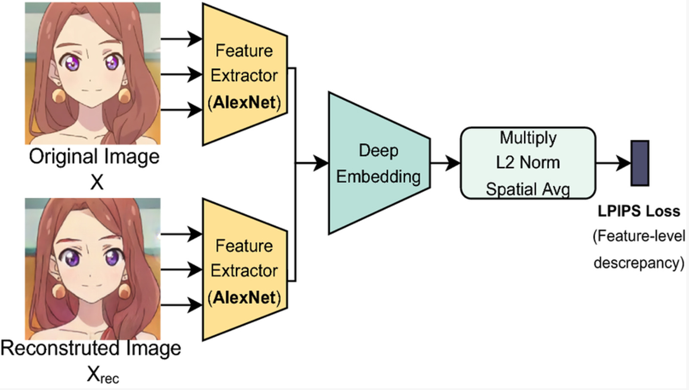
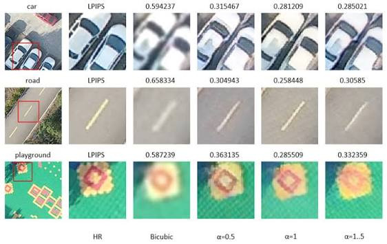
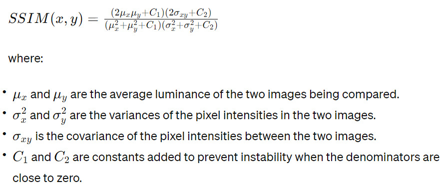
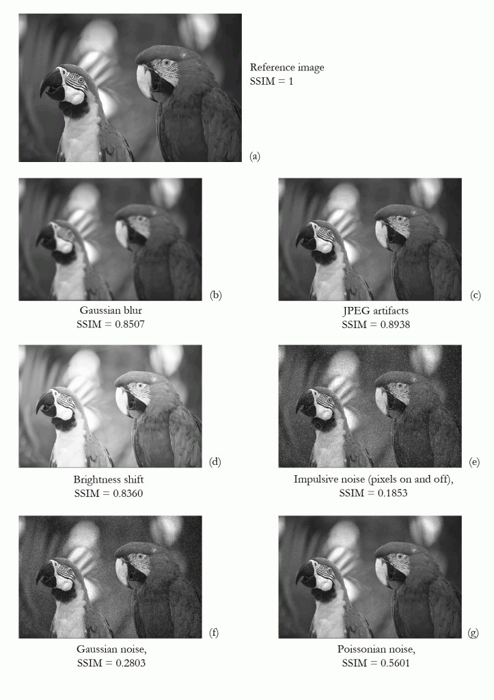
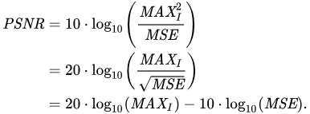
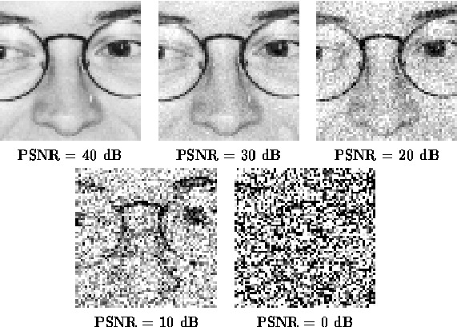

# Métricas de comparação de imagens: LPIPS, SSIM e PSNR

Estas três métricas comparam duas imagens: a imagem de referência (*ground truth*) e uma renderização do modelo 3D reconstruído, vista do mesmo ângulo. No benchmark do Espresso3D, elas avaliam o quanto cada modelo (TripoSR, Stable Fast 3D e InstantMesh) se aproxima do objeto real quando visto de novas perspectivas (*novel views*).

| Métrica | O que mede | Faixa de valores | Melhor quando |
|---|---|---|---|
| **LPIPS** | Diferença perceptual, medida por uma rede neural | 0 em diante | Menor ↓ |
| **SSIM** | Semelhança de estrutura, luminância e contraste | até 1 | Mais próximo de 1 ↑ |
| **PSNR** | Relação entre sinal e ruído, em decibéis (dB) | 0 a infinito | Maior ↑ |

---

## LPIPS (*Learned Perceptual Image Patch Similarity*)

O LPIPS mede a diferença entre duas imagens como uma pessoa a perceberia. Em vez de comparar pixel a pixel, ele passa as duas imagens por uma rede neural pré-treinada (como a AlexNet), que extrai características visuais de cada uma. Essas características são comparadas pela norma L2, e o resultado é a média espacial dessas diferenças.

*Figura 1: cálculo do LPIPS. As duas imagens passam por extratores de características (AlexNet), e a diferença entre elas define o valor da métrica.*

**Interpretação:** quanto **menor** o LPIPS, mais semelhantes as imagens são perceptualmente.

*Figura 2: variação do LPIPS conforme o método de reconstrução aplicado a uma imagem de alta resolução (HR). A interpolação bicúbica tem os valores mais altos, ou seja, é a menos fiel perceptualmente.*

---

## SSIM (*Structural Similarity Index Measure*)

O SSIM também mede a percepção de semelhança entre duas imagens, mas com base em três componentes: luminância, contraste e estrutura.

*Figura 3: fórmula do SSIM. μx e μy são as luminâncias médias das duas imagens; σx² e σy² são as variâncias das intensidades dos pixels; σxy é a covariância entre as duas imagens; C1 e C2 são constantes que evitam instabilidade quando os denominadores se aproximam de zero.*

**Interpretação:** quanto **mais próximo de 1**, mais parecida a reconstrução é com a imagem de referência. O valor 1 indica imagens idênticas.

*Figura 4: SSIM da mesma imagem após diferentes distorções: desfoque gaussiano (0,8507), artefatos de JPEG (0,8938), mudança de brilho (0,8360), ruído impulsivo (0,1853), ruído gaussiano (0,2803) e ruído de Poisson (0,5601). Os ruídos derrubam o SSIM muito mais do que o desfoque ou a mudança de brilho.*

---

## PSNR (*Peak Signal-to-Noise Ratio*)

O PSNR mede, em decibéis, a relação entre o valor máximo possível de um pixel (MAX_I) e o erro quadrático médio (MSE) entre as duas imagens. É uma métrica pixel a pixel, sem modelar a percepção humana.

*Figura 5: fórmula do PSNR, em três formas equivalentes.*

**Interpretação:** o PSNR varia de 0 a infinito. Quanto **maior**, mais próxima a reconstrução está da *ground truth*. Imagens idênticas (MSE = 0) têm PSNR infinito.

*Figura 6: a mesma imagem com PSNR decrescente. Com 40 dB, a diferença é imperceptível; com 0 dB, a imagem vira ruído.*
